<p align="center">
  
</p>

# BENCH WORK 2026–2027

**Digital Learning & Practicum Guide — Politeknik ATMI Surakarta**

Website pembelajaran dan praktikum **Bench Work** Politeknik ATMI Surakarta. Repository ini memuat materi kerja bangku, simulasi 3D, penilaian, SOP, K3, serta galeri alat ukur dan perlengkapan pendukung.

## Instruktur Bench Work

| Chandra Galih Wisudawan | Sudibtia Titio Koin | Hieronimus Vikko Purohita |
|:---:|:---:|:---:|
|  |  |  |

> Nama dan urutan foto instruktur mengikuti `readme.txt`. Pastikan berkas fotonya menggunakan nama di atas.


## Galeri Foto Alat Ukur dan Perlengkapan Pendukung

Klik gambar untuk membuka file foto di GitHub.

| Foto 1 | Foto 2 | Foto 3 |
|:--:|:--:|:--:|
| <a href="images/alat-ukur-01-hair-line.jpg">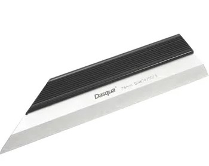</a> | <a href="images/alat-ukur-02-square-line.jpg">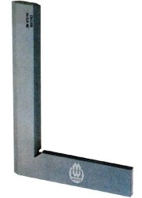</a> | <a href="images/alat-ukur-03-dial-caliper.jpg">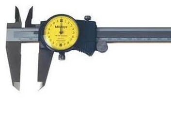</a> |
| **Hair Line / Knife Straight Edge** | **Square Line / Engineer Square** | **Dial Caliper** |
| <a href="images/alat-ukur-04-vernier-caliper.jpg">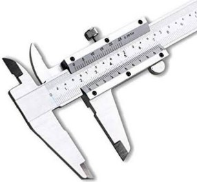</a> | <a href="images/alat-ukur-05-micrometer.jpg">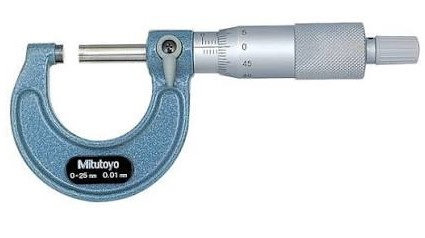</a> | <a href="images/alat-ukur-06-mall-gauge.jpg">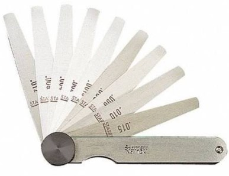</a> |
| **Vernier Caliper** | **Micrometer** | **Feeler Gauge / Mall Gauge** |
| <a href="images/alat-ukur-07-outside-dial.jpg">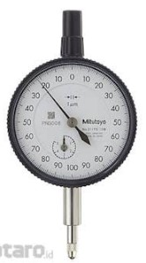</a> | <a href="images/alat-ukur-08-bevel-protractor.jpg">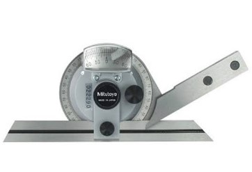</a> | <a href="images/alat-ukur-10-cylinder-square-block.jpg">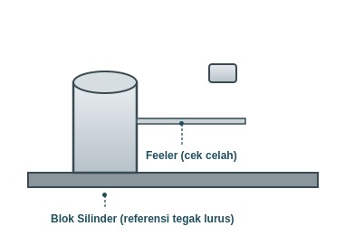</a> |
| **Outside Dial / Dial Indicator** | **Bevel Protractor** | **Cylinder Square Block** |
| <a href="images/alat-ukur-11-height-gauge.jpg">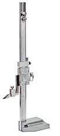</a> | <a href="images/alat-ukur-12-rugotest.jpg">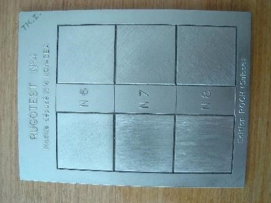</a> | <a href="images/alat-ukur-13-vitriol.jpg">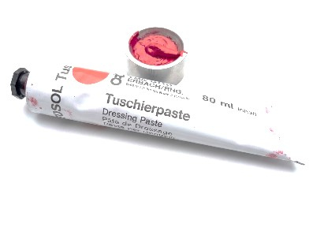</a> |
| **Height Gauge** | **Rugotest (Pembanding Kekasaran Permukaan)** | **Vitriol / Tuschierpaste (Pasta Penandaan)** |
| <a href="images/alat-ukur-14-angle-gauge.jpg">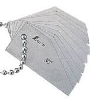</a> | <a href="images/alat-ukur-15-bevel-transfer.jpg">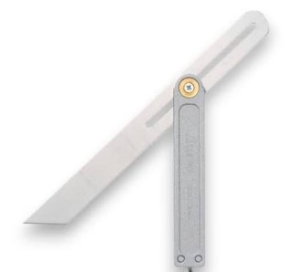</a> | <a href="images/alat-ukur-16-depth-caliper.jpg">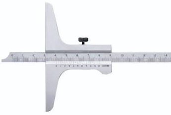</a> |
| **Angle Gauge** | **Bevel Transfer** | **Depth Caliper** |
| <a href="images/alat-ukur-17-plug-gauge.jpg">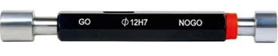</a> | <a href="images/alat-ukur-18-plug-thread-gauge.jpg">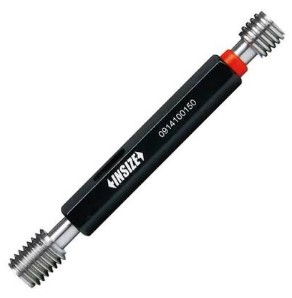</a> | <a href="images/alat-ukur-19-radius-gauge.jpg">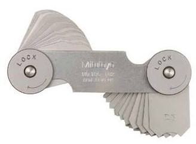</a> |
| **Plug Gauge** | **Plug Thread Gauge** | **Radius Gauge** |

## Struktur Folder Repository

Simpan `README.md` dan `index.html` pada folder utama repository, sedangkan semua gambar disimpan di dalam folder `images/`:

```text
BENCH-WORK/
├── README.md
├── index.html
└── images/
    ├── logo-atmi.jpg
    ├── foto-instruktur-1.jpg
    ├── foto-instruktur-2.jpg
    ├── foto-instruktur-3.jpg
    ├── alat-ukur-01-hair-line.jpg
    ├── alat-ukur-02-square-line.jpg
    ├── alat-ukur-03-dial-caliper.jpg
    ├── alat-ukur-04-vernier-caliper.jpg
    ├── alat-ukur-05-micrometer.jpg
    ├── alat-ukur-06-mall-gauge.jpg
    ├── alat-ukur-07-outside-dial.jpg
    ├── alat-ukur-08-bevel-protractor.jpg
    ├── alat-ukur-10-cylinder-square-block.jpg
    ├── alat-ukur-11-height-gauge.jpg
    ├── alat-ukur-12-rugotest.jpg
    ├── alat-ukur-13-vitriol.jpg
    ├── alat-ukur-14-angle-gauge.jpg
    ├── alat-ukur-15-bevel-transfer.jpg
    ├── alat-ukur-16-depth-caliper.jpg
    ├── alat-ukur-17-plug-gauge.jpg
    ├── alat-ukur-18-plug-thread-gauge.jpg
    └── alat-ukur-19-radius-gauge.jpg
```

**Catatan:** Kartu **Surface Table** di website tetap dipertahankan tetapi foto khususnya (`images/alat-ukur-09-surface-table.jpg`) belum tersedia pada kumpulan 18 foto. Foto Cylinder Block merupakan ilustrasi penggunaannya dan bukan foto Surface Table tersendiri.

**Catatan kategori:** Vitriol/Tuschierpaste merupakan bahan bantu penandaan atau pemeriksaan kontak permukaan, bukan alat ukur langsung; di website dikelompokkan sebagai perlengkapan pendukung.


## Cara Menampilkan di GitHub

1. Buka repository GitHub **BENCH WORK** pada branch tempat website disimpan (umumnya `main`).
2. Jika `README.md` sudah ada, buka dan klik ikon pensil **Edit this file**, lalu ganti isinya dengan README gabungan ini. Atau unggah file `README.md` untuk mengganti versi lama pada branch yang sama.
3. Pastikan folder `images/` berisi logo ATMI, ketiga foto instruktur, dan 18 foto alat ukur sesuai nama file di atas.
4. Klik **Commit changes**, lalu buka halaman utama repository. GitHub akan menampilkan logo, foto instruktur, dan galeri alat ukur sesuai urutan.

Untuk website GitHub Pages, pastikan juga `index.html` merujuk ke berkas foto yang sama. **README hanya mengatur tampilan halaman repository, bukan foto pada website.** Jika ingin menerbitkan website, buka **Settings → Pages → Build and deployment**, pilih **Deploy from a branch**, lalu branch website dan folder `/(root)`.

### Jika foto belum terlihat

- Folder harus bernama persis `images` (huruf kecil).
- Nama berkas dan ekstensi `.jpg` harus sama persis (huruf besar/kecil berpengaruh).
- Klik gambar pada repository untuk memeriksa apakah file benar-benar tersedia.
- Untuk perubahan di GitHub Pages, coba muat ulang paksa (`Ctrl + F5`).
